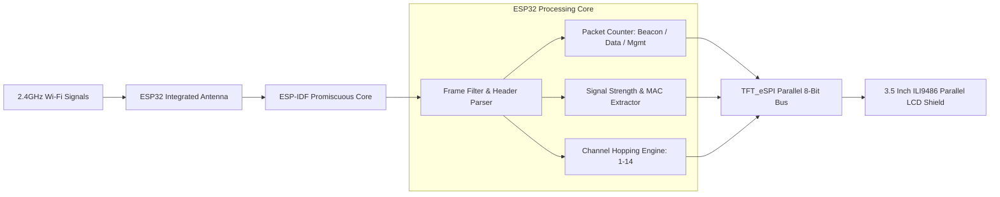
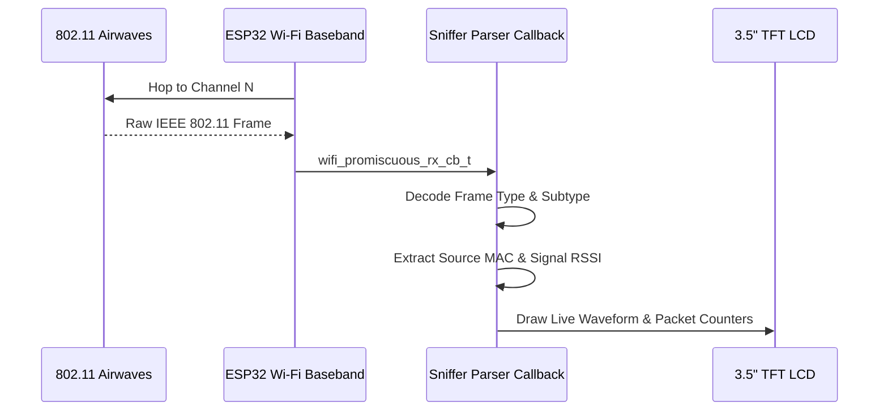

# ESP32 Cyber Packet Sniffer

<div align="center">

[](https://isocpp.org)
[](https://espressif.com)
[](https://github.com/Bodmer/TFT_eSPI)
[](LICENSE)

</div>

A standalone embedded wireless analysis dashboard built for the ESP32 and 3.5-inch 8-bit parallel TFT shields. Captures raw IEEE 802.11 frames in promiscuous mode and renders real-time wireless metrics and channel telemetry.

---

## Hardware Architecture & Signal Flow



---

## System Pipeline



---

## Technical Specifications

- **Microcontroller**: ESP32 Dual-Core Tensilica LX6 (240MHz)
- **Supported Display**: 3.5" Arduino Uno Parallel TFT Shield (ILI9486 / ST7796)
- **Data Bus**: 8-bit parallel interface utilizing GPIOs `12, 13, 26, 25, 17, 16, 27, 14`
- **Capture Capabilities**:
  - IEEE 802.11b/g/n raw frame capture
  - Management frames (Beacons, Probe Requests/Responses, Deauth frames)
  - Data frames and payload packet volume
  - Dynamic RSSI decibel telemetry

---

## Hardware Pinout Reference

| TFT Shield Pin | ESP32 GPIO | Function |
| :--- | :--- | :--- |
| **LCD_CS** | GPIO 33 | Chip Select |
| **LCD_RS (CD)** | GPIO 15 | Register Select / Command-Data |
| **LCD_WR** | GPIO 4 | Write Strobe |
| **LCD_RD** | GPIO 2 | Read Strobe |
| **LCD_RST** | GPIO 32 | Hardware Reset |
| **LCD_D0 - D7** | `12, 13, 26, 25, 17, 16, 27, 14` | 8-Bit Data Bus |

---

## Installation & Setup

1. Clone this repository:
   ```bash
   git clone https://github.com/Midhun-M-git/Esp32_Cyber_packet_sniffer.git
   cd Esp32_Cyber_packet_sniffer
   ```

2. Configure TFT_eSPI:
   - Copy `User_Setup.h` from this repository to your Arduino libraries folder:
     `Arduino/libraries/TFT_eSPI/User_Setup.h`

3. Flash Firmware:
   - Open `esp32_sniffer.ino` in Arduino IDE or PlatformIO.
   - Select Board: `ESP32 Dev Module`.
   - Set CPU Frequency: `240MHz (WiFi/BT)`.
   - Click **Upload**.

---

## License

This project is licensed under the MIT License. See the [LICENSE](LICENSE) file for details.
